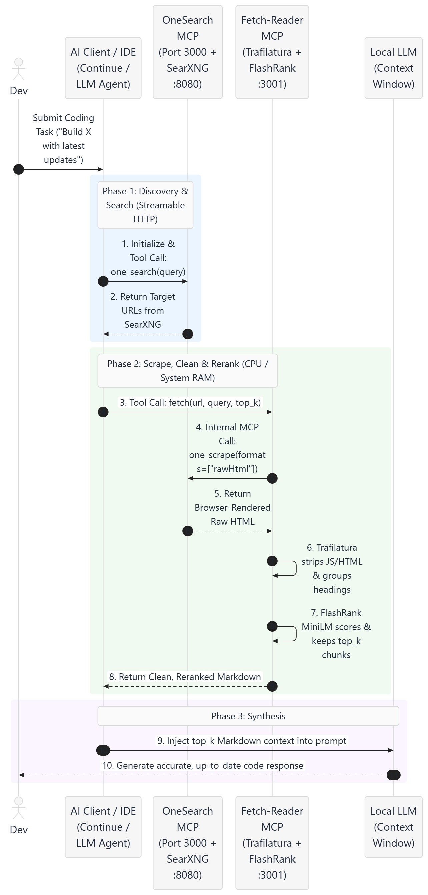

This repository is where I build and push images that will be used for my MCP-Server-Installation-Pipeline project. Some of the images are push as is and some  are built with the necessarcy installation dependencies. Here I make full use of my GHCR and elimanate all external dependnecies- so that the k3s server will be pulling soley from my GHRC without having to worry about having surprises a long the road- like a deleted or renamed image.

The repository contains two Dockerfiles: 
1. `Dockerfile.onesearch`: This Dockerfile builds an image for the OneSearch with mcp-proxy already installed and configured to run on port becuase the Onessearch is an stdio application it needs mcp-proxy be reachable in a k3s pod via streamable http. 

2. `Dockerfile.fetch`: This Dockerfile builds an image for the Fetch Reader with the MCP SDK and other dependencies installed. It also pre-downloads the FlashRank model , a reranker model that is used for ranking search results to minimize token usage and improve the quality of the search results. The Fetch Reader image also includes the python script fetch_rerank_server.py which is built into the docker image. fetch_rerank_server.py's job is to fetch and rerank search results from the MCP API, where it calls onescrape to fetch the search results for Terafilatura to clean the HTML and FlashRank to rerank the results. The reranked results are then returned to the client for the LLM to consume. 

Below is a simple usecase that demonstrates how the fetch reader and onesearch work when an LLM request the content of a webpage:

# License, Copyright & Liability Disclaimer

**Copyright © 2026 Bokken LLC. All Rights Reserved.**

This repository is made public solely for technical demonstration purposes for prospective clients and collaborators evaluating local AI and business infrastructure solutions.

* **Permitted Use:** You may view, clone, and run this code locally strictly for personal, educational, or client/hiring evaluation purposes.
* **Prohibited Use:** You may not copy, modify, redistribute, sublicense, publish, or deploy any part of this codebase in any production, commercial, or public project without prior written permission from Bokken LLC.
* **Third-Party Software:** Any third-party open-source packages, models, or binaries referenced or bundled in these Dockerfiles (including `mcp-proxy`, Trafilatura, and FlashRank) remain the property of their respective owners and are governed by their original open-source licenses.

### Disclaimer of Warranty & Limitation of Liability

**THIS SOFTWARE AND DOCUMENTATION ARE PROVIDED "AS IS," WITHOUT WARRANTY OF ANY KIND, EXPRESS OR IMPLIED, INCLUDING BUT NOT LIMITED TO THE WARRANTIES OF MERCHANTABILITY, FITNESS FOR A PARTICULAR PURPOSE, AND NONINFRINGEMENT. IN NO EVENT SHALL BOKKEN LLC OR ITS MEMBERS BE LIABLE FOR ANY CLAIM, DAMAGES, OR OTHER LIABILITY—WHETHER IN AN ACTION OF CONTRACT, TORT, OR OTHERWISE—ARISING FROM, OUT OF, OR IN CONNECTION WITH THE SOFTWARE OR THE USE OR OTHER DEALINGS IN THE SOFTWARE.**

For commercial licensing inquiries or permission requests, please contact **jash@stny.rr.com**.